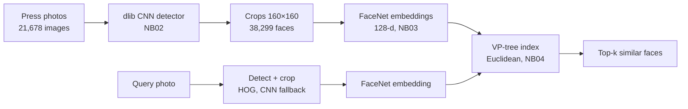

# Face Similarity Search Pipeline

End-to-end face search over a 21,678-photo press archive: dlib CNN face detection, FaceNet embeddings and a VP-tree index, evaluated against brute-force search and calibrated with ROC and F1 analysis.

**[Live demo (static)](https://santiagodie.github.io/face-similarity-search-pipeline/)**: a gallery of synthetic faces (SFHQ, CC0) with precomputed embeddings, not the original dataset.

**Full demo in Colab:** [](https://colab.research.google.com/github/santiagodie/face-similarity-search-pipeline/blob/main/space/build_demo_index.ipynb). Use *Run all* to get the complete Gradio app, where you can upload your own photo (see [Demo](#demo)).

## Overview

Given a photo of a person, the goal is to find every appearance of that person in a large archive of news photos. The project builds the full pipeline across five Jupyter notebooks: it analyses the dataset, compares three face detectors and three face-recognition models, crops and normalises every face, indexes 38,299 face embeddings in a VP-tree, and evaluates the result. Each step is justified with measurements on the real data.

The photos are press images published by the Government of La Rioja. The course provided the dataset, and it is not included in this repository (see [Privacy and ethics](#privacy-and-ethics)).

Built for the Artificial Intelligence course at the University of La Rioja (2025–26).

## Features

- **Dataset analysis:** resolution and file-size statistics for 21,678 images, plus a quick Haar-cascade scan (parallelised with a thread pool) that finds at least one face in 82.2% of them.
- **Detector comparison:** Haar cascades, dlib HOG + linear SVM and dlib CNN (MMOD) on the same 200-image sample, compared on time, number of detections and visual precision.
- **Face cropping:** each detection gets a 20% margin and is resized to 160×160 px. The file name `{source_image}_{face_index}.jpg` keeps every crop traceable to its photo.
- **Embedding model comparison:** VGG-Face (4096-d), OpenFace (128-d) and FaceNet (128-d) through DeepFace, timed on 1,000 crops.
- **VP-tree index:** Euclidean-distance VP-tree over all 38,299 FaceNet embeddings, with top-k nearest-neighbour queries.
- **Gradio app (code in notebook 04):** two modes, either searching from an already-cropped face or from a full photo. Full-photo mode detects every face (HOG first, CNN as a fallback), embeds them in batches and streams results per face.
- **Evaluation:** VP-tree compared with vectorised linear search, a self-retrieval test, and similarity-threshold calibration with a ROC curve and a precision/recall/F1 sweep.

## Tech stack

Python · Jupyter / Google Colab · OpenCV · dlib (HOG, CNN MMOD) · DeepFace with TensorFlow / tf-keras (FaceNet, VGG-Face, OpenFace) · `vptree` · NumPy · scikit-learn · Matplotlib · Gradio

## Architecture / how it works



| Notebook | Step | Key result |
|---|---|---|
| `Trabajo_AnalisisDataset_01.ipynb` | Dataset analysis | 21,678 images (54 unreadable), most commonly 640×480, 640×426 or 800×600; 82.2% with a Haar-detectable face |
| `Trabajo_DeteccionCaras_02.ipynb` | Face detection and cropping | CNN chosen for having no false positives; full run on a local GPU in 2,914 s, producing 38,299 crops |
| `Trabajo_Embeddings_03.ipynb` | Face embeddings | FaceNet chosen: 128-d vectors (cheaper to index than VGG-Face's 4096-d) |
| `Trabajo_Vptree_y_Busqueda_04.ipynb` | VP-tree search and Gradio app | Top-k search over all 38,299 embeddings |
| `Trabajo_Evaluacion_05.ipynb` | Evaluation | See results below |

The notebooks, including their explanations and variable names, are written in Spanish, the language of the course.

**Measured results (from the saved notebook outputs):**

- **Detectors** (200 photos, Colab GPU): Haar found 579 faces in 72.2 s, HOG 349 in 50.5 s, and CNN 347 in 19.4 s. Haar had the highest recall but clear false positives. CNN was chosen because a missed face harms the index less than a non-face crop.
- **Embedding models** (1,000 crops, Colab T4): VGG-Face took 82.7 s, OpenFace 136.0 s and FaceNet 280.2 s.
- **Search speed** (200 queries, k = 1 to 50): vectorised NumPy linear search took 13.5–16.4 ms per query, against 110–174 ms for the `vptree` index.
- **Self-retrieval** (500 random indexed faces): 472/500 (94.4%) returned themselves as the nearest neighbour.
- **Threshold calibration** (5,000 positive and 5,000 negative pairs):
  - The ROC-optimal distance is 9.719 (TPR 0.978, FPR 0.169).
  - The F1-optimal distance is 9.655 (precision 0.854, recall 0.975, F1 0.911).

**Scaling the detection step.** Running dlib CNN over the full dataset needed several attempts, all documented in notebook 02:

1. Colab's free tier ran out of memory.
2. CPU-only inference was estimated at about 70 hours.
3. A thread pool failed because the dlib CNN model is not thread-safe.
4. A process pool exhausted virtual memory on Windows, where `spawn` loads one model per worker.

What finally worked was a sequential run on a local GPU with CUDA and cuDNN.

**The Gradio app.** Its code is the final cell of notebook 04. Since the free Hugging Face tier has no GPU, it detects faces with HOG and only falls back to CNN when HOG finds nothing. Other details:

- Input photos are downscaled to at most 600 px.
- It processes at most 10 faces per photo, in chunks of 3.
- Face embeddings are cached in an LRU cache (200 entries, keyed by a BLAKE2b hash of the crop).
- Progress is streamed to the UI with a generator.

The app was deployed on Hugging Face Spaces during the course; that deployment is not public. The same app, extracted to `space/app.py`, now runs on synthetic faces in the Colab demo (see [Demo](#demo)).

## Getting started

> **Not re-verified.** The requirements and steps below are taken from the notebooks as they were run during the course. They have not been reinstalled or re-run for this repository.

**Requirements**

- Python 3.13 (local runs) or Google Colab with a T4 GPU.
- A GPU is effectively required for notebooks 02 and 03. The local runs used CUDA 12.4, cuDNN 9 and Visual Studio Build Tools to build dlib with CUDA support.
- Packages installed by the notebooks (no versions are pinned):

  ```bash
  pip install opencv-contrib-python matplotlib cmake dlib deepface tf-keras vptree gradio scikit-learn
  ```

  Notebook 03 also installs `tensorflow[and-cuda]` for local GPU inference, which is Linux-only.

**Data**

The dataset, face crops, embeddings and serialised index are not published. In the notebooks, their download URLs are replaced with the placeholders `DATASET_URL`, `FACE_CROPS_URL`, `EMBEDDINGS_URL` and `VPTREE_URL`. To run the pipeline you need your own folder of photos. Then replace the placeholders, or skip the download cells and point the path variables at local folders. The dlib MMOD model and the DeepFace weights are downloaded from their public sources.

**Running**

From the repository root, open the notebooks in Jupyter or Colab (notebooks 01, 03, 04 and 05 have an "Open in Colab" badge) and run them in order, 01 to 05. Each notebook expects the outputs of the previous one.

## Demo

Both demos use synthetic faces from the 750-image sample of SFHQ part 3 ([Kaggle](https://www.kaggle.com/datasets/selfishgene/synthetic-faces-high-quality-sfhq-part-3), CC0), never the original dataset.

- **[Live demo (static)](https://santiagodie.github.io/face-similarity-search-pipeline/):** a gallery with precomputed embeddings, served by GitHub Pages from `docs/`. Pick one of the 23 faces and the page ranks all 115 crops by Euclidean distance in the browser (exact linear search). It marks the results within the 9.655 threshold and those that belong to the same face.
- **Full demo in Colab:** [](https://colab.research.google.com/github/santiagodie/face-similarity-search-pipeline/blob/main/space/build_demo_index.ipynb) Use *Run all*. The notebook downloads the faces, runs the pipeline and starts the full Gradio app from `space/app.py` with a temporary public link (`*.gradio.live`), where you can upload your own photo.

The demo index contains **23 synthetic faces (115 crops)**: the ones Kaggle allows downloading without authentication. Each face appears in 5 versions: the original, a tighter crop, a slight rotation, a brightness change and a horizontal flip. Every image goes through the same pipeline as the original project: dlib detection, a 160×160 crop with a 20% margin, and FaceNet embeddings.

The Gradio app was originally deployed on Hugging Face Spaces, but free CPU hardware is no longer available for this account, so the full demo now runs in Colab. The Space files are kept in `space/` in case it can be redeployed.

| Path | Purpose |
|---|---|
| `space/build_demo_index.ipynb` | Colab notebook: install, download faces, detect and crop, embeddings and VP-tree, run the app |
| `space/app.py` | The Gradio app from notebook 04, adapted to load a local index and filter results at the F1-optimal threshold (9.655) |
| `space/packages.txt` | System dependencies for the Space |
| `space/README.md` | The Space card, with its YAML header |
| `space/examples/` | Six SFHQ faces for one-click queries |
| `space/sfhq_pt3_sample_manifest.txt` | The 750 SFHQ part 3 files the notebook tries to download |
| `docs/` | Static demo: `index.html`, `embeddings.json` (115 FaceNet embeddings with file names and identities) and `faces/` (the 115 crops) |

The files the notebook generates (`vptree.pkl` and `carasRecortadas/`) are not tracked in this repository. The static demo's `embeddings.json` and `faces/` were exported once from one of those runs.

## Known limitations

- **VP-tree speed:** the VP-tree is roughly 8–11× slower than linear search here (pure-Python `vptree` against vectorised NumPy over 38K vectors). Notebook 04's conclusion still claims an O(log n) improvement; notebook 05's measurements contradict it.
- **Inconsistent threshold:** notebook 05 applies a threshold of 9.69, while the computed values are 9.719 (ROC) and 9.655 (F1).
- **Threshold only in the demo app:** in the notebooks the threshold only appears as a snippet in notebook 05, and the app cell in notebook 04 does not filter by distance. `space/app.py` does apply it.
- **No real labels:** threshold calibration assumes each face's nearest neighbour is the same person. There are no identity labels to verify it.
- **Not reproducible end to end:**
  - Notebooks 01 and 02 mix Colab paths (`/content/2`) with local paths (`noticiasFotos/2`).
  - Some sections depend on functions defined in earlier sections that were run in a different environment.
  - Some saved outputs do not match the current code.
- **App tied to the course setup in the notebook:** the app cell in notebook 04 still downloads its index from placeholder URLs and its example images are not included. The runnable version is `space/app.py`, which uses the synthetic-face index.
- **Remote pickles:** the embeddings and index are loaded with `pickle` from remote URLs, which is unsafe with untrusted sources.
- **Detection errors:** 1,590 of the 21,678 images raised errors during CNN detection and were skipped.
- **No pinned versions:** dependencies are installed with unpinned `pip install` cells.

## Privacy and ethics

The pipeline processes faces of real, identifiable people, which is biometric data. For that reason, this repository does **not** publish:

- the press-photo dataset or the 38,299 face crops;
- the face embeddings (`embeddings.pkl`) or the serialised index (`vptree.pkl`);
- any notebook output showing photos or faces, which were removed from the full git history;
- a running instance of the search app over the original data.

Only the code, the text outputs and four aggregate charts (resolution scatter, file-size histogram, ROC curve and precision/recall/F1 curves) remain in the notebooks. The public demo indexes synthetic faces only.

## What I learned

- **Algorithmic complexity is not the same as wall-clock time.** A metric tree with good theoretical behaviour lost to a single vectorised NumPy operation at this scale because of interpreter overhead per distance call.
- **Thread-safety and memory determine how you parallelise.** dlib's CNN model could not be shared across threads, and one model per process exhausted memory, so the practical answer was moving the work to a GPU.
- **Choose components for what happens downstream.** I picked the detector with fewer false positives over the one with higher recall, because a non-face crop pollutes the embedding index.
- **Calibrating without ground truth needs explicit assumptions.** Using nearest neighbours as pseudo-positive pairs gives a usable threshold, but it should be reported as an estimate, not an accuracy figure.

## Credits

- [PyImageSearch](https://pyimagesearch.com/) tutorials on Haar-cascade face detection, dlib HOG/CNN face detection and VP-tree search engines. The `convert_and_trim_bb` helper comes from the dlib tutorial.
- [dlib](http://dlib.net/) by Davis King, including the `mmod_human_face_detector` model from [dlib-models](https://github.com/davisking/dlib-models).
- [DeepFace](https://github.com/serengil/deepface) by Sefik Ilkin Serengil, which provides the FaceNet, VGG-Face and OpenFace models and weights.
- [vptree](https://pypi.org/project/vptree/), [OpenCV](https://opencv.org/) (Haar cascade) and [Gradio](https://www.gradio.app/).
- Press photos by the Government of La Rioja, provided by the course. They are not redistributed.
- Demo faces from [Synthetic Faces High Quality (SFHQ)](https://github.com/SelfishGene/SFHQ-dataset) by David Beniaguev, part 3, CC0. The licensing caveats are listed in `space/README.md`.

## License

The code is released under the [MIT License](LICENSE). The license does not cover the dataset, which is not part of this repository.
